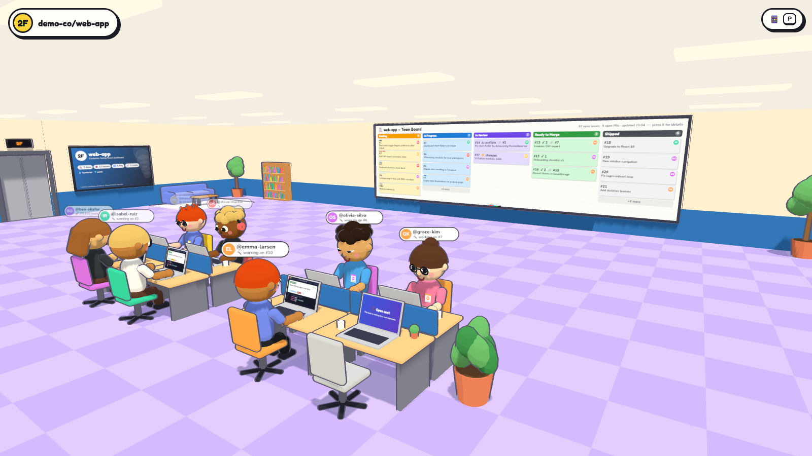
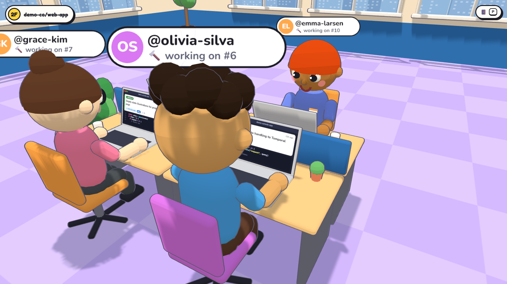
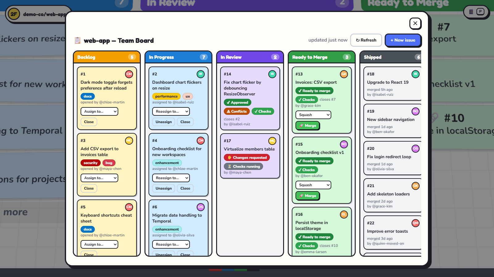
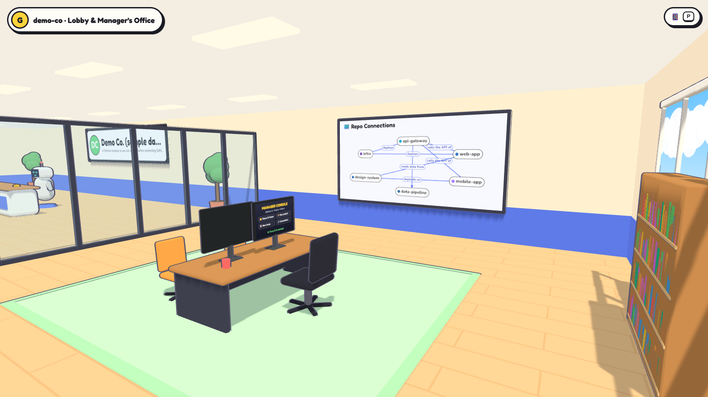
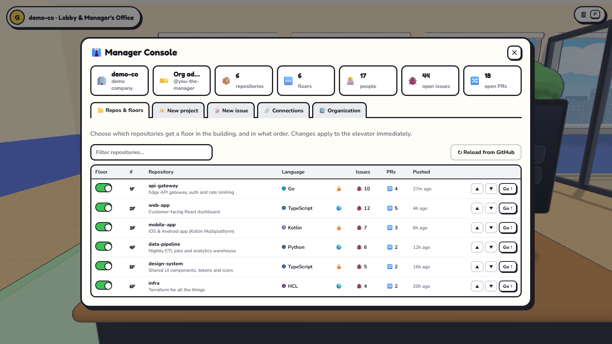
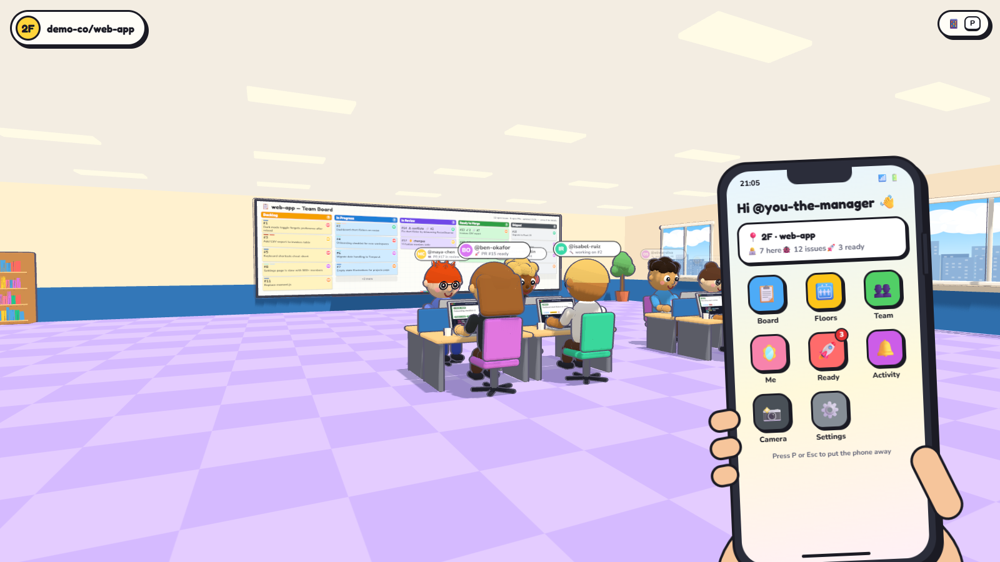
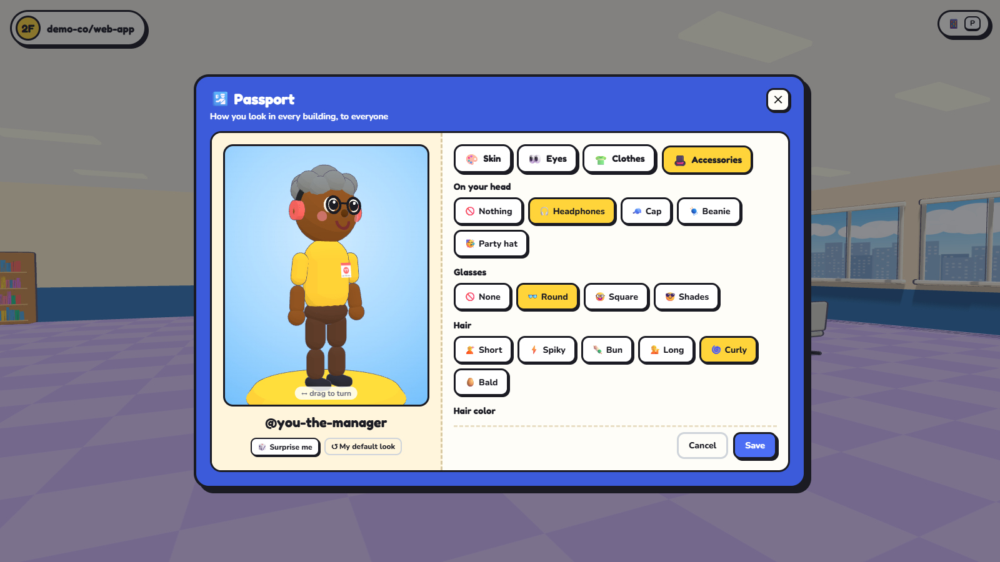

# Worktown3D 🏢

[](https://github.com/bermarques/worktown3d/actions/workflows/build.yml)

**Walk around your GitHub organization.** Worktown3D turns an organization into a cartoon office you explore in
first person: every repository is a floor, every current team member sits at a desk, and their laptop shows what
they're working on right now.

**[Try it at worktown3d.com](https://worktown3d.com)** · [Run it yourself](#quick-start) ·
[API repository](https://github.com/bermarques/worktown3d-api)



## Highlights

- **One floor per repository.** Ride the elevator between them. The lobby has the building directory, a front-desk
  robot and the glass Manager's Office.
- **Real people, real work.** Characters are the repo's contributors who are still in the organization. Each laptop
  shows that person's assigned issue, open PR or last shipped PR, and their name tag says what they're on.
- **A team board on every floor.** Backlog → In Progress → In Review → Ready to Merge → Shipped. Assign, close and
  merge without leaving the building.
- **The Manager's Office.** Choose which repos get floors, create repositories, write issues and map how repos connect.
- **A phone in your pocket.** Any floor's board, the team, PRs ready to merge, recent activity, a camera and settings.
- **Your own character.** Design how you look in every building, from skin tone to headphones.
- **Play together.** In an organization's building you see the teammates who are there at the same time.
- **Only what GitHub allows.** Everyone signs in with GitHub and sees the building through their own permissions.

## Take a tour

<table>
  <tr>
    <td width="50%"><br><sub>Every dev at their laptop, showing what they're working on</sub></td>
    <td width="50%"><br><sub>The team board: assign, close issues and merge ready PRs</sub></td>
  </tr>
  <tr>
    <td width="50%"><br><sub>The Manager's Office and its repo connections map</sub></td>
    <td width="50%"><br><sub>The Manager Console: floors, new projects, issues and connections</sub></td>
  </tr>
  <tr>
    <td width="50%"><br><sub>Your phone: boards, floors, team, ready PRs and more</sub></td>
    <td width="50%"><br><sub>The passport: design your character</sub></td>
  </tr>
</table>

<sub>Screenshots from the built-in demo company, which uses fictional data.</sub>

## How it's built

Worktown3D is two repositories:

- **worktown3d** (this one): the web app. The 3D client (Three.js, no build step) and a small web server that
  serves it and forwards `/api`, `/auth` and `/stripe` to the API, so the browser only ever talks to one address.
- **[worktown3d-api](https://github.com/bermarques/worktown3d-api)**: the API. GitHub access, sign-in, building
  settings, characters, multiplayer and subscriptions.

Both run in one of two modes:

- **Local mode**: just you, on your machine, acting through the GitHub CLI (`gh`). No setup beyond `gh auth login`.
- **Hosted mode**: your whole team. Everyone signs in with GitHub and sees the building through **their own**
  GitHub permissions: only the repos they can access, and only the actions they're allowed to take.

## Quick start

You need Node.js 20.19+ (or 22.12+). Clone both repositories side by side, then start the API and the web app in two
terminals:

```bash
git clone https://github.com/bermarques/worktown3d-api
cd worktown3d-api
npm install
npm run dev          # API on http://127.0.0.1:3001
```

```bash
git clone https://github.com/bermarques/worktown3d
cd worktown3d
npm install
npm start            # open http://localhost:3000
```

Without the GitHub CLI you get the fictional **demo company**, so you can look around right away. To force demo mode
even when `gh` is set up, run `npm run build`, then `npm run demo`, in the API.

To see your real organization:

1. Install the GitHub CLI: `winget install --id GitHub.cli` (or see https://cli.github.com).
2. Sign in: `gh auth login`. The default scopes, `repo` and `read:org`, are what Worktown3D needs.
3. On the title screen press **Check again**, then pick an organization (or your personal account).

## Hosted mode

Set up the API first: the GitHub App, PostgreSQL, Stripe and its variables are described in the
[worktown3d-api README](https://github.com/bermarques/worktown3d-api#readme). Then run this app next to it:

| Variable | Value |
| --- | --- |
| `PUBLIC_URL` | the address people open, like `https://worktown3d.example.com` (the same value as the API's) |
| `API_URL` | the API's private address, like `http://127.0.0.1:3001`; never a public URL |
| `PORT` | default `3000` |

```bash
cp .env.example .env       # then fill in PUBLIC_URL and API_URL
npm ci --omit=dev
npm start
```

With `PUBLIC_URL` set, the app listens on all interfaces and only answers for that host name. Put it behind HTTPS,
with a reverse proxy like Caddy or nginx or a platform such as Railway. The GitHub App's callback URL and the Stripe
webhook point at this app (`PUBLIC_URL/auth/callback`, `PUBLIC_URL/stripe/webhook`), which forwards them to the API.
Multiplayer is a WebSocket on `/api/live`, so a reverse proxy in front of this app has to pass WebSocket upgrades
through. Caddy and Railway do; nginx needs `proxy_http_version 1.1` and the `Upgrade` and `Connection` headers.

### On Railway

Run two services in one project, plus the PostgreSQL service:

1. **worktown3d-api**, from the API repository: set `PORT=8080`, `TRUST_PROXY=1`, `PUBLIC_URL`,
   `DATABASE_URL=${{Postgres.DATABASE_URL}}` and the GitHub and Stripe variables. Don't give it a public domain:
   only the web app talks to it, over Railway's private network.
2. **worktown3d**, from this repository: set `PUBLIC_URL` and
   `API_URL=http://${{worktown3d-api.RAILWAY_PRIVATE_DOMAIN}}:8080`, and generate its public domain.

Both services need the same `PUBLIC_URL`, so update both when you add a custom domain.

### Share the building

Open your organization's building and copy its link from the title screen or the Manager Console
(`https://your-host/o/your-org`). Teammates who open it sign in with GitHub. The app checks that they're members of
the organization and shows them exactly what their GitHub access allows:

| Who | Sees | Can do |
| --- | --- | --- |
| Org owner (admin) | everything they can access on GitHub | everything, including floor layout, repo connections and new projects |
| Member | repos they can read | open issues; assign and close with triage access; merge with write access |
| Not a member | nothing | they're told they're not part of the organization |

People who leave the organization lose access within a few minutes, and they stop appearing as characters.

### Subscriptions

With Stripe configured on the API, an organization's building only opens while it's connected to an active
subscription. Customers sign in with GitHub → **Subscribe** (Stripe Checkout) → install the GitHub App on their
organization → **Connect** it on the title screen → share the building link with the team. Teammates don't pay.
The Basic plan connects **one organization**, and the subscriber's **personal building is free** while one of their
organizations is subscribed. Cards, invoices and cancelling are handled in Stripe's customer portal (**Manage billing**).

## Playing

| Key | Action |
| --- | --- |
| `W A S D` / arrows | walk (`Shift` to run) |
| Mouse | look around (click the scene to capture the mouse) |
| `E` or click | interact with whatever is under the crosshair |
| `P` | take out or put away your phone |
| `Esc` | pause, or close a panel |

If the browser can't capture the mouse (some embedded browsers), it switches to **drag to look**.

### What's in the building

- **Elevator** (west wall on every floor): walk in, press `E` at the button panel and pick a floor.
- **Repo floors**, one per repository. Desks are arranged in pods, and people who are busy sit closest to the board.
  - **Characters** are the repo's contributors who are **still members of the organization**. People who left aren't
    shown (the floor sign tells you how many). Members who are assigned issues or have open PRs show up even before
    their first commit.
  - **Laptop screens** show the person's current assigned issue, otherwise their open PR, otherwise the last PR they
    shipped. People with nothing assigned wander off to the **coffee corner**. Press `E` on anyone for details.
  - **Team board** (north wall): press `E` for the full board, where you can assign, unassign and close issues and
    merge ready PRs, as your permissions allow. A PR is *ready to merge* when it isn't a draft, has no conflicts,
    has no failing checks and is approved.
- **Lobby (G)**: the building directory, the team wall, a front-desk robot with tips, and the **Manager's Office**:
  - **Manager Console** (desk monitor): choose which repos get floors and in what order, create blank repos (they get
    a floor right away), write issues with assignees and labels, map repo **connections** (depends on, calls the API
    of, deploys…), share the building and switch organizations.
  - The **Repo Connections** wall map shows those links, and each floor sign lists them too.

Data refreshes every 30 seconds while you're on a floor, and toasts announce new issues, new PRs, PRs becoming ready
and merges.

### Your phone (`P`)

A shortcut to everything, from anywhere in the building:

- **📋 Board**: any floor's team board (not just the one you're on), plus "New issue".
- **🛗 Floors**: tap a floor to ride there.
- **👥 Team**: who's on this floor, or everyone in the organization with the floors they work on and what they're
  doing. People in the building right now come first, with where they are (🟢). **Take me there** rides to their
  floor and puts you next to them (or by their desk, with a bouncing marker over their head).
- **🚀 Ready**: every PR that's ready to merge across all floors, with a merge button.
- **🔔 Activity**: new issues, PRs, merges and your own actions; the 📱 chip shows unread news.
- **🪞 Me**: your passport, to design your character.
- **📸 Camera**: snapshot the office (without the HUD) and save it as a JPEG.
- **⚙️ Settings**: mouse sensitivity, field of view, name tags, shadows, outlines and sounds (remembered per browser).

### Your character

Everyone gets a look drawn from their GitHub login. If you signed in with your own GitHub account (or, in local mode,
the GitHub CLI is), you can design your own: phone → **🪞 Me** opens your **passport**, with tabs for **Skin**,
**Eyes** (shape and color), **Clothes** (shirt and pants) and **Accessories** (hats, headphones, glasses, hair style
and color). Drag the preview to turn it; **🎲 Surprise me** rolls a random look and **↺ My default look** goes back
to the drawn one.

**Save** stores it on the API, so it follows you between sessions and devices. It's how everyone sees you: at your
desk on the floors you work on, whether or not you're online, and walking around when you're in the building.
Teammates in the building with you see the change at once; everyone else sees it with their next floor refresh.

### Play together

In an organization's building you see the teammates who are there at the same time, walking around the floors with
a 🟢 name tag, and they see you. While someone is on a floor, their desk character there steps away, so each person
appears once (you included). The 🟢 chip under the floor name says how many others are in the building; click it, or
open **👥 Team** on the phone, to see where they are and **Take me there**. Personal buildings and the demo company
are single-player. If the same person opens the building in two tabs, others see the newest one.

## Project layout

```
server.js                  web server: static files, CSP and security headers, proxy to the API
public/js/api.js           calls to the API (same origin, through the proxy)
public/js/main.js          renderer, game loop, floors, elevator rides, polling, actions
public/js/live.js          multiplayer: the /api/live WebSocket, who's in the building, sending your position
public/js/permissions.js   which buttons the viewer gets, from their GitHub permissions
public/js/world/*          building, furniture, characters, repo floor, lobby, canvas screens, other players
public/js/ui/*             HUD, panels, Kanban, phone, manager console, title screen, plan card, passport
scripts/smoke.js           smoke test: serves the page and its whole module graph, checks headers and the proxy
```

Rendering is Three.js with toon materials and an outline pass, loaded through an import map with no bundler. Static
furniture is merged into a handful of draw calls, and floors seat up to 48 people (the rest are listed as working
remotely) to stay smooth.

The [Build](.github/workflows/build.yml) workflow runs on every pull request, on Node 20, 22 and 24: it installs,
checks the syntax of every file, starts the app and runs `scripts/smoke.js` against it.

## Security

Sign-in, tokens and permissions are handled by the API. This app adds a strict Content-Security-Policy and only
answers for its own host name. See [SECURITY.md](SECURITY.md), and the
[API's SECURITY.md](https://github.com/bermarques/worktown3d-api/blob/main/SECURITY.md) for the rest. Please report
vulnerabilities privately, as described there.

## Roadmap

- **Bigger plans.** Subscriptions that connect more than one organization.
